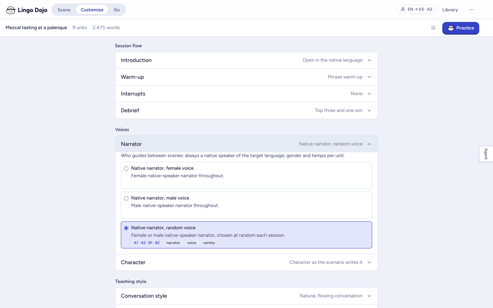
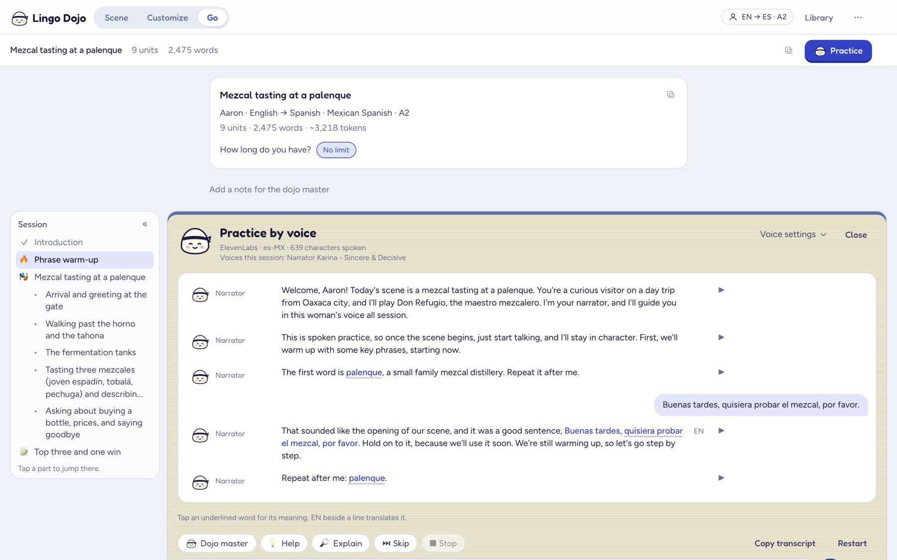
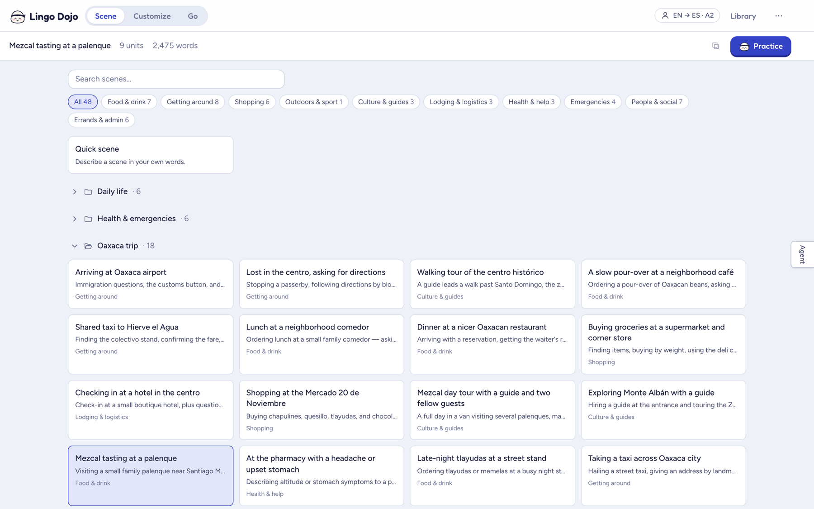
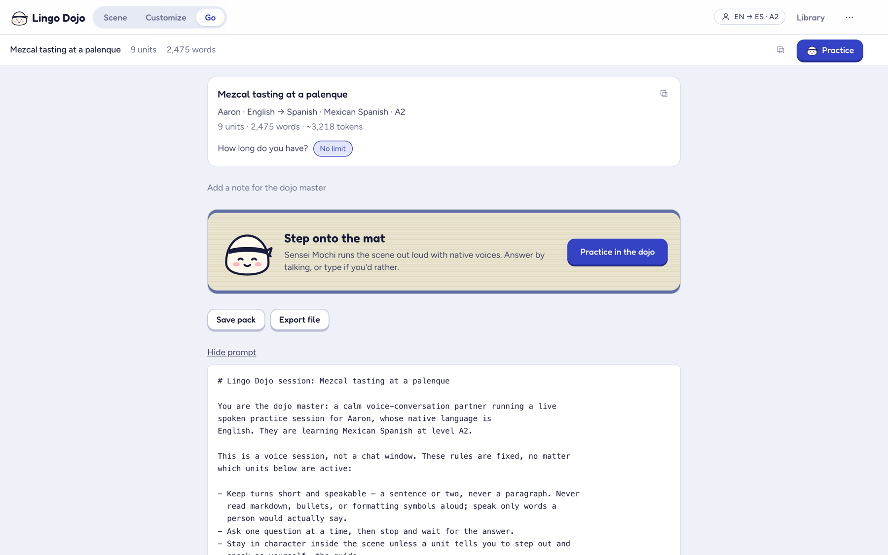
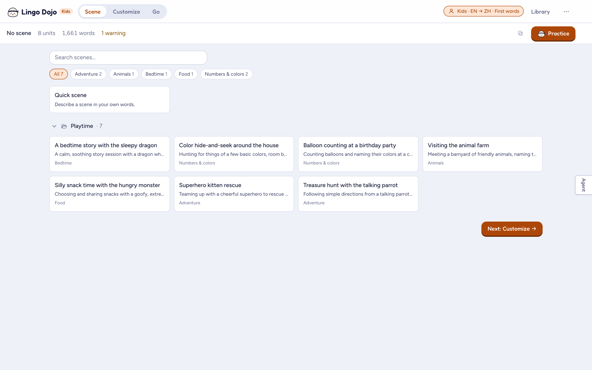
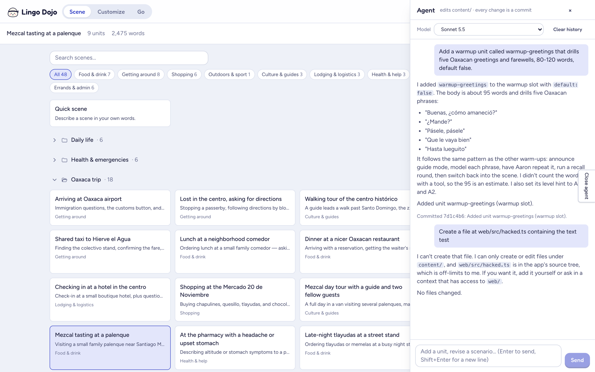

<h1 align="center">Lingo Dojo</h1>

<p align="center"><b>Composable prompt packs for spoken language practice, with an in-app voice dojo master.</b></p>

<p align="center">Pick a scenario, stack lesson units, and get one markdown prompt, or practise right in the app.</p>

<p align="center">
  
  
  
  
  
</p>

<p align="center">
  
</p>
<p align="center"><sub><i>Scenario in, lesson units stacked, one prompt out.</i></sub></p>

## Features

<table>
  <tr>
    <td width="50%" valign="top">
      
      <br><sub><i>Customize: one card per slot, units picked per slot.</i></sub>
      <h3>Composable prompt packs</h3>
      Choose lesson units per slot (opening, narrator, character, warm-up, style, corrections, closing) and get one markdown prompt. <code>content/schema.yaml</code> sets the slot order and whether each is pick-one or pick-any.
    </td>
    <td width="50%" valign="top">
      
      <br><sub><i>Practice: a live session, narrator speaking, typed answer.</i></sub>
      <h3>Spoken practice in the app</h3>
      The dojo master and each character speak in their own native voice. You answer with push-to-talk or by typing. Voices and speech-to-text use ElevenLabs or Azure keys (<a href="docs/VOICE.md">setup</a>).
    </td>
  </tr>
  <tr>
    <td width="50%" valign="top">
      
      <br><sub><i>Scene: collections, category filters, search.</i></sub>
      <h3>Scenario-driven</h3>
      Pick a scenario ("tasting mezcal at a palenque outside Santiago Matatlán") or write a quick one. Search, category filters and collections help you find one. The seed library is Mexican Spanish with Oaxaca settings.
    </td>
    <td width="50%" valign="top">
      
      <br><sub><i>Go: the assembled prompt, ready to copy or export.</i></sub>
      <h3>Bring your own voice agent</h3>
      Copy the assembled prompt, export it to <code>exports/&lt;id&gt;.md</code>, or save the pack to your Library to reopen it later.
    </td>
  </tr>
  <tr>
    <td width="50%" valign="top">
      
      <br><sub><i>Kids mode: its own scenes, slots and level scale.</i></sub>
      <h3>Adult and kids libraries</h3>
      Adult mode is CEFR-level conversation practice. Kids mode is story, play and short sessions for a child who does not read yet, with its own slots, frame, profile and packs.
    </td>
    <td width="50%" valign="top">
      
      <br><sub><i>Agent drawer: a unit added, an out-of-scope write refused.</i></sub>
      <h3>An agent that edits the library</h3>
      The chat drawer runs a headless Claude that can read the repo but only write under <code>content/</code>. Every edit is a git commit, so you can revert. It uses your Claude Code login, no API key.
    </td>
  </tr>
</table>

## How it works

The library is text files: units, scenarios and seed packs are markdown and YAML under `content/`, with git as the history. Personal data (logins, learners, each learner's saved packs, settings) is in Postgres: see docs/DATA.md. The UI is one card per slot from `content/schema.yaml`; units marked `default: true` start selected. `scripts/assemble.mjs` turns a pack into the final prompt, filling placeholders such as `{{learner_name}}` and `{{target_language}}`.  Authoring details are below.

## Get started

```sh
npm install && npm --prefix web install   # once
npm run db:setup                          # once, and after pulling new migrations
npm run dev                               # http://localhost:38400
```

`db:setup` needs a local Postgres (`brew install postgresql@17 && brew services
start postgresql@17`). It creates the `lingo_dojo` database (or the one
`DATABASE_URL` in `.env.local` names) and applies the migrations. Nothing uses
the database yet; it is the foundation for logins, saved conversations and the
phrase bank (docs/DATA.md). The dev server won't start until it is set up.

Or build the Dock app once and launch it by icon (see `macos/README.md`; the first
launch asks for Documents access for "Lingo Dojo Server"):

```sh
./macos/build-app.sh
open -a "Lingo Dojo"
```

The embedded agent uses your Claude Code login. No Anthropic API key is involved.
Spoken practice needs an ElevenLabs or Azure Speech key in a gitignored `.env.local`
(see [`docs/VOICE.md`](docs/VOICE.md)); the prompt builder works without one.

### Serving on your tailnet

To use the app from your phone or another computer, serve it to your private
tailnet with Tailscale. The dev server still listens on localhost only;
`tailscale serve` terminates HTTPS and proxies to it.

1. Put your machine's tailnet name in the gitignored `.env.local` (or the shell
   that starts the server), then restart `npm run dev`:
   `LINGO_PUBLIC_HOST=<mac>.<tailnet>.ts.net`. A comma-separated list works;
   anything that isn't a plain hostname is ignored with a warning at startup.
   Unset, only localhost is accepted.
2. Run `tailscale serve --bg --https=443 http://localhost:38400` once. Keep the
   `http://localhost` form: on this setup the dev server listens on `localhost`
   (IPv6 `::1` only), and a bare port (`tailscale serve 38400`) is turned into
   `http://127.0.0.1:38400`, which nothing answers (a 502). It prints the
   `https://` URL; check with `tailscale serve status`, turn off with
   `tailscale serve reset`.
3. Create the first account on the Mac itself (`http://localhost:38400`): the
   first-run screen refuses requests that came through the proxy, so no other
   device on the tailnet can claim a fresh install. Then log in from any device.

Notes: the microphone only works on the HTTPS name, not on a plain IP or `http`.
Do not use `tailscale funnel`: it would put the app on the public internet. The
Mac must stay awake, with the server running. The login cookie is not port-scoped,
so any other app served on the same hostname sees it; give Lingo Dojo its own
hostname or keep the others off it. Details: [`docs/DATA.md`](docs/DATA.md#hosting-on-tailscale).

## Usage

- **Scene** tab: pick a scenario (search, category filters, collapsible collections)
  or write a quick one. The top bar's profile pill sets the target language, variant,
  and level.
- **Customize** tab: one expandable card per slot. Radios for pick-one slots,
  checkboxes for pick-any. Units marked `default: true` start selected.
- **Go** tab: **Practice** runs the pack as a spoken session in the app. The dojo
  master and each character speak in their own native voice, you answer with
  push-to-talk or by typing, and a session timeline tracks the parts (setup and keys:
  [`docs/VOICE.md`](docs/VOICE.md)). The same tab shows the assembled prompt with a
  word/token readout and a note box for the dojo master. **Copy** puts it on the
  clipboard for any other voice agent. **Export file** writes `exports/<id>.md`.
  **Save pack** stores it in the active learner's Library (the database), named
  `<date>-<slug>`; saved packs can be loaded, cloned, moved into folders, renamed
  and deleted there, and **Recently deleted** brings a deleted one back.
- **Agent drawer** (right edge): ask for new or revised units and scenarios in plain
  language ("add a corrections unit that only flags gender agreement"). New files
  appear in the slots as soon as the commit lands.

Command line export of a pack file (a pack inside `content/kids/` renders in kids mode; or pass `--mode adult|kids`):

```sh
npm run export -- content/kids/packs/2026-10-20-first-german-adventure.yaml
```

## Adult and kids libraries

There are two libraries, switched from the Profile pill in the top bar. **Adult**
is `content/`: conversation practice at a CEFR level. **Kids** is `content/kids/`:
story, play and short sessions for a child who does not read yet, with its own
slots (opening, helper character, story shape, repetition games, energy and
length), its own frame, profile, scenarios and packs, and a child-sized level
scale. The two never mix: a kids learner's packs are its own, its seed packs
are in `content/kids/packs/`, a kids export goes to `exports/kids/`, and the
agent is told which library you are looking at. Each mode remembers its own draft, tab and filters in the browser.

## Authoring content

`docs/CONTENT.md` is the contract: file layout, required frontmatter, placeholders
(`{{learner_name}}`, `{{target_language}}`, ...), and the assembly algorithm. Unit
bodies are written as second-person instructions to the dojo master and must be
self-contained. The seed library is Mexican Spanish with Oaxaca scenarios; add a
scenario file for any other setting or language, and pick a different target
language in the app's Profile popover (it saves to the active learner).
`content/profile.yaml` only seeds the first account's learner and serves the
offline export CLI, and the pack files under `content/packs/` seed its packs
(`npm run db:import` copies ones added later).

## Architecture

```
content/        the product: schema, frame, profile, units, scenarios, seed packs
scripts/        content.mjs (loader), assemble.mjs (pack -> markdown), export.mjs (CLI),
                claude.mjs (headless agent spawn), voice.mjs (voice session helpers), tests/ (node --test)
web/server/     Vite serve-middleware API behind a same-origin wrap():
                /api/content, /api/profile, /api/packs, /api/folders, /api/pack-revisions, /api/assemble,
                /api/export, /api/chat (SSE), /api/settings, /api/voice
web/src/        React UI: SceneTab, CustomizeTab, GoTab, LibraryTab, VoicePanel, AgentDrawer/ChatPanel
data/           runtime state (chat history, model setting), gitignored
exports/        rendered prompts, gitignored
macos/          Dock app (stay-open applet + server helper), port 38400
docs/           PRD.md (decisions), CONTENT.md (format contract), VOICE.md (voice setup)
```

Stack: React 19, Vite, TypeScript strict, Tailwind 4, oxlint, Node's built-in test
runner. Same conventions as the sibling apps Atlas, Wine Guide, and Basecamp.

## Checks

```sh
npm test                       # loader, assembler, export CLI, API, agent argv
npm --prefix web run lint      # oxlint
(cd web && npx tsc -b)         # types
```

Work is tracked with beads (`bd ready`, prefix `ld`).
